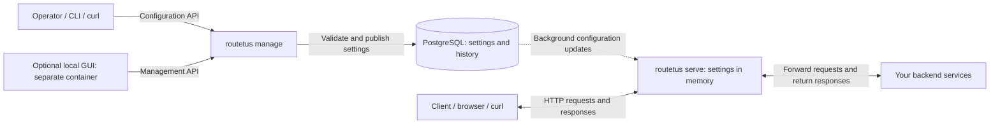

# Routetus

Routetus is a Go HTTP API gateway with operational configuration stored in PostgreSQL.
A separate management process validates and publishes immutable revisions; serving
processes route requests using compiled in-memory snapshots. Kubernetes or another
serving platform handles replica scaling.

- No configuration SQL on the proxy request path.
- Route handler state is independent, even when routes use the same handler ID.
- Atomic publication with generation preconditions and complete-candidate validation.
- Invalid revisions preserve the last valid snapshot; stale instances reject new traffic.
- Streaming HTTP, SSE, and WebSocket support with resource limits and graceful draining.
- Bearer-authenticated management and verified upstream TLS.
- Optional route policies for headers, concurrency, request rate, token access, and body size.

PostgreSQL 17 or later is required. See the executed checks and deployment limits
before choosing production capacity; no universal requests-per-instance guarantee is made.

## Architecture

## Get started

Follow [getting_started.md](getting_started.md) for installation, the Docker demo,
and native processes. Download binaries from
[GitHub Releases](https://github.com/kmpoltorak/routetus/releases).
An optional [local configuration GUI](getting_started.md#local-route-gui) manages routes and upstreams and attaches existing route handlers. It runs in a separate container with Light, Dark, and System appearance choices.

## Documentation

| Document | Contents |
| --- | --- |
| [Configuration reference](docs/reference.md) | Sources, fields, defaults, constraints, bootstrap YAML |
| [Management API and CLI](docs/api.md) | Commands, endpoints, ETags, examples, errors, secrets |
| [OpenAPI contract](docs/openapi.json) | Generated machine-readable API schema |
| [Operations](docs/operations.md) | Routing, handlers, TLS/proxy trust, scaling, synchronization, shutdown, limitations |
| [Extensions](docs/extensions.md) | Registering and testing handlers |
| [Verification and development](docs/verification.md) | Make targets, test evidence, security checks, known test limits |
| [Benchmarks](docs/benchmarks.md) | Measurements, methodology, capacity limits |
| [Release notes](docs/release_notes.md) | Changes and upgrade requirements |

Built with an AI coding assistant. I wrote the spec and reviewed every change.

## License

[MIT](LICENSE).
